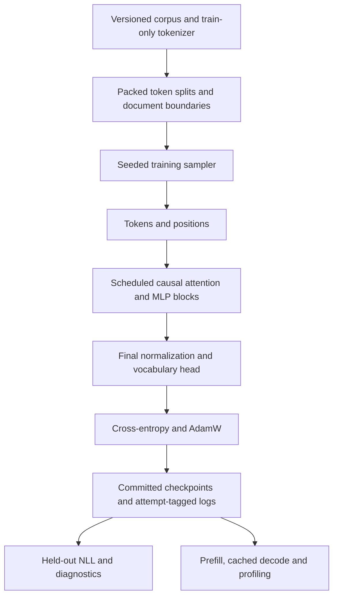

# Shared-core recurrent Transformer

The baseline implements a conventional pre-LayerNorm causal decoder. The recurrent candidate retains its block operator and changes how often each learned block is applied. The intended comparison isolates tying at equal applied depth and explores extra computation at equal stored block count. The public [baseline source](https://github.com/CL-BAF/Domovoi-Labs/tree/5e76fc78bbe9a5c12690e84d7c29e558248e6feb) is the independent audit reference. Paths for the recurrent and pilot implementation refer to the local tree identified by the [source manifest](../provenance/RTX5080-BF16-SMOKE-001-source.json).



## Input representation and block math

For token IDs $X$ of shape $[B,T]$, the initial residual stream has shape $[B,T,d]$. It is the sum of learned token embeddings and learned absolute position embeddings. The default table has 512 rows. Tying the output head to the input embedding saves one $V\times d$ matrix while retaining the output projection on each position. At the output a final LayerNorm precedes logits $[B,T,V]$. The next-token loss is averaged over the targets in a microbatch. Equal-sized microbatches allow scaling each loss by the accumulation count to obtain the update's mean gradient.

For residual state $x_j$ entering application $j$ and block index $s_j$, the block computes:

$$
u_j=x_j+\operatorname{Attention}_{s_j}(\operatorname{LN}_{1,s_j}(x_j)),\qquad
x_{j+1}=u_j+\operatorname{MLP}_{s_j}(\operatorname{LN}_{2,s_j}(u_j)).
$$

A fused linear projection emits Q, K and V from the normalized state, then reshapes each to $[B,h,T,d/h]$. Attention computes $\operatorname{softmax}(QK^\top/\sqrt{d/h}+M)V$, where the causal mask admits only keys at a query's position or earlier. The output projection mixes heads back into width $d$. The MLP maps $d\to f\to d$ with GELU between the linear maps. The residual path provides a direct identity contribution to the Jacobian. It gives no bound on the norm of the full product of Jacobians. Biases and learnable gains and biases in both LayerNorms are included.

The module list stores $n$ independent parameter sets. The recurrence schedule contains $A=nr$ applications for recurrence depth $r$. For $n=3,r=2$, cycle is `0,1,2,0,1,2` and sequence is `0,0,1,1,2,2`. A conceptual excerpt from the shared forward path is:

```python
for block_idx, cache in zip(schedule, caches):
    x, new_cache = self.blocks[block_idx](x, cache=cache)
    if use_cache:
        new_caches.append(new_cache)
```

The index selects a module object. A reused block receives a new residual state and its gradient is the sum of each use's contribution. The gradient into earlier states still flows through later uses. Separate activations are needed for backpropagation and separate KV entries are needed for generation. The code uses effective depth to scale residual projection initialization by $1/\sqrt{2A}$. Correlated repeated updates can defeat the intuition behind that scaling. The independent CPU check compared tied gradients with a sum over untied copies at the same weights, with maximum FP64 difference $6.94\times10^{-18}$ on the tested small models. No trained stability guarantee follows.

Parameter sharing across Transformer depth is established prior work. Domovoi uses fixed schedules and tests resource and quality trade-offs on a causal decoder. Adaptive halting and variable test-time computation are distinct approaches. [Universal Transformers](https://arxiv.org/abs/1807.03819) · [Takase and Kiyono's layer-sharing study](https://arxiv.org/abs/2104.06022) · [Geiping et al. on recurrent depth](https://arxiv.org/abs/2502.05171)

## Inference and causal KV cache

Prefill uses square causal attention. With a prefix of length $p$, cached query $i$ in a newly appended chunk admits keys through index $p+i$. A single decoded query admits all cached and newly appended keys. Position IDs begin at $p$, which matters because they index a learned table. By induction over applications, a token's state depends only on its sequence prefix. The tested CPU matrix had zero future-token leakage and maximum cached/uncached FP64 logit difference $2.22\times10^{-16}$ across 96 combinations of models, seeds and chunkings. FP32 differences depend on kernel choice.

Cache slot $j$ corresponds to the incoming state at application $j$, even if its block index repeats. `kv_cache.py` validates length, layout, dtype, device and available model/schedule provenance. Plain lists can retain structural validity without retaining provenance. The cache stores sequence-length state, so this design has no bounded recurrent state across tokens. Prefill K and V can retain the backing fused QKV allocation, which makes retained storage 1.5 times the logical cache on the observed prefill path. Decode currently concatenates K/V tensors and can temporarily keep old and new allocations live. Static caches, grouped-query attention, or a compact recurrent state would change the storage or execution profile and require separate controls.

## Complexity and measurement

Let $C$ be position-table length, $V$ the vocabulary count, $n$ the stored block count, and $A$ the applied block count. One biased block costs $P=4d^2+2df+9d+f$ parameters. Stored parameters for a tied head are $(V+C)d+2d+nP$. Applied parameters replace $nP$ by $AP$ and count repeated uses. An untied head adds $Vd$ stored parameters. Approximate forward FLOPs per token at attended length $L$ are:

$$
A(8d^2+4df+4dL)+2Vd.
$$

One multiply-add counts as two FLOPs. Square causal prefill has $T(T+1)/2$ logically valid attention pairs per layer, although dense kernels can execute work for masked positions. Decode has $L$ near the cached context. Training matmul estimates approximate forward plus backward as three times forward. These estimates omit elementwise operators, allocator overhead, kernel and launch effects, and AdamW. Activation storage grows with applied depth during training, even when parameter, gradient and optimizer storage scale with unique weights. A materialized attention matrix can grow quadratically in sequence length. Fused attention can avoid retaining the full matrix.

Logical cache bytes are $2B A T d b$, where $b$ is the bytes per KV value. For width 640, $A=16$, batch 1, 8,192 positions and BF16, this is 320 MiB for either tied or untied block depth. A theoretical resized learned table and tied head give B16 about 132.73 MiB of weights and R02×8 about 29.72 MiB. Their logical sums are 452.73 and 349.72 MiB, a 22.75% reduction. The current trained context limit is 512, and these 8K figures were derived from the dimensions. They exclude retained Q storage, logits, workspace, drivers, allocator effects and transient cache copies. A new positional control and workload measurement are required for 8K. [RoFormer](https://arxiv.org/abs/2104.09864)

The profiler reports weight and cache dtypes independently, finds peak allocated/reserved bytes through CUDA counters, and synchronizes CUDA around timed generation. Time to first token measures model prefill plus first sampling. Decode throughput excludes the first token sampled from prefill. Device-wide use is a snapshot. Total device peak and output quality at the qualifying workload are still open.

## Training and evidence flow

| Subsystem | Implementation and rationale | Limit |
|---|---|---|
| Registry and config | `config.py` and `models/__init__.py` validate architecture and model dimensions. A common schema and block operator let controls share the same pipeline. | Extending context changes position parameters and requires a new control. |
| Data and sampler | `datasets/prepare.py` packs uint16 IDs and identifies tokenizer/splits. `loader.py` indexes a memory map. The pilot takes a seeded permutation of disjoint $T+1$-token segments and stores the cursor; historical runs sample random offsets. | Document-packed parquet preparation and contamination checks remain separate from the synthetic smoke. |
| Optimizer | `trainer.py` accumulates mean-normalized losses, clips accumulated gradients, and steps AdamW with matrix-only decay and a warmup/cosine schedule. BF16 autocast uses FP32 model parameters. CUDA peak allocator statistics are tracked around training. | Tied gradients and optimizer work differ between equal-depth arms. Statistical and hardware effects require measurement. |
| Lifecycle | `checkpoint.py` persists model tensors as safetensors, plus optimizer, scheduler, RNG, data provenance and a graph signature. Training serializes writes with a cooperative lock, refuses changed protocol, and loads a backup before publishing recovery. Raw metrics are append-only and the reader reconciles attempts. | A hard crash can leave a stale lock. Pickle-backed resume state requires trusted checkpoints. |
| Pilot stops | `pilot_limits.py` checks post-warmup rolling loss, sustained pre-clip norm, CUDA allocation and runtime. Nonfinite losses or norms stop the appropriate training path before committing the affected step. | Synthetic checks exercise mechanics. They provide no estimate of real-corpus failure rates. |
| Evaluation | `full_split_nll.py` sums within-document token losses and divides by the exact target count. Partial windows are retained. Document bootstrap samples whole documents, independently of seed uncertainty. Early exits apply the final LayerNorm and head to intermediate residual states for diagnosis. | The head was optimized for final depth. Fixed random-window validation and full-split NLL are different measurements. |
| Experiment bookkeeping | `experiments/registry.py`, `metrics_log.py` and CLI tools record IDs, protocol deviations, environment and status. The research repository holds milestone records and artifact links. | Immutable implementation provenance must be captured before each counting run. |

A fair first pilot uses B02 for equal stored parameters and B08 for equal applied depth, with paired seeds and fixed tokenizer, corpus, segment order, optimizer and token budgets. DML-0001 used a different dataset and execution environment. It remains a historical pipeline check. The performance hypotheses and next discriminating checks are in the [5080 record](../experiments/RTX5080-BF16-SMOKE-001.md).
