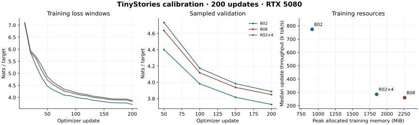

# TinyStories calibration analysis · matched 200-step comparison

This supplements the [original record](TINYSTORIES-CALIBRATION-2026-11-24.md) and both [V1](data/TINYSTORIES-CALIBRATION-v1.json) and [V2](data/TINYSTORIES-CALIBRATION-v2.json) result files. The [portable archive](data/archive/) adds complete configs, raw metric rows, validation, telemetry, command receipts and checkpoint metadata without discarding either trajectory.

Each arm processed 200×16,384 = 3,276,800 scored tokens at context 512 with a shared tokenizer and disjoint sampling. The deterministic run was pinned to [d914684](https://github.com/CL-BAF/Domovoi-Labs/commit/d914684dc730cd32132aeff389d6291c447ed7e4). Unique counts recompute as 10,665,856 for B02/R02×4 and 33,812,224 for B08. Step-rate medians exclude the first 20 updates and equal 773,561.4, 260,022.25 and 285,290.2 tok/s. Full FP32 validation NLLs are 3.7147498, 3.8418439 and 3.8873302 nats/target respectively. [Timing and figure methods](../methodology/measurement-methodology.md)

## Why B02 led early

B02 was ahead of B08 by **0.12709 nats/target** and R02×4 by **0.17258**. That corresponds to 3.31% of B08 and 4.44% of R02×4 NLL. The observation is for one paired seed and a short, fast-decaying LR horizon. The data do not identify a causal explanation.

| Explanation | Current observation and uncertainty | Discriminating test |
|---|---|---|
| Depth can complicate early optimization | B08's largest logged pre-clip norm was 18.315, compared with 1.9951 for B02 and 4.0631 for R02×4. These are sparse samples, and R02×4 also trailed without a measured B08-sized spike. | Record per-update clipping frequency and per-layer/per-use norms in a preregistered ablation. |
| Warmup and LR sensitivity | Only ten warmup steps and a 200-update horizon. Eight applications have different effective-depth residual scales and may respond differently. | Use a fixed LR/warmup grid at matched budgets with identical selection criteria. |
| Initialization and random variation | Equal seed pairs data. Parameter shapes and effective-depth scaling differ, and there is no seed replication. | Repeat paired seeds. Separately compare tied blocks and their untied copies at matched initial states. |
| Corpus and duration | TinyStories is templated synthetic narrative. Narrow regularities may reward a shallow model early. The extended ranking changes with token budget under a longer schedule. | Use preregistered longer runs with fixed schedules, then a broader frozen and decontaminated corpus. |
| Tied gradients | R02×4 was 0.04549 nats behind B08 at the same eight applications. Tying sums per-use gradients and restricts parameter diversity. | Track per-use gradient alignment, compare fixed-rate and fixed-wall budgets, and include sequence ordering. |

## Resource and loss trade

B08 has 23,146,368 extra unique parameters over R02×4. At 16 bytes per parameter for FP32 weights, gradients and two Adam moments, that is **353.19 MiB** in an estimated tensor subtotal. The extra serialized optimizer state is approximately **176.65 MiB**. Peak allocated differs by **406.33 MiB**, or **18.00%** of B08, and reserved differs by **400 MiB**, or **16.33%**. Actual peaks overlap multiple lifetimes. The accounting and allocation figures cannot isolate the contribution of workspaces, activations or kernels.

R02×4's synchronized rate is **9.72% higher** than B08's and its full validation NLL is **0.04549 nats/target worse**, 1.18% relative to B08. The corresponding perplexity increase is about 4.65%. The dense matmul estimate is equal at eight applications. Savings in optimizer state or memory traffic could explain throughput, but no kernel profile measures the decomposition. The trade may be attractive under a constrained training budget and may be irrelevant where B02 is adequate or B08's extra quality is required. The [100M-token campaign](TINYSTORIES-EXTENDED-2026-11-24.md) observes a later R02×4 gain over B02 and a persistent gap behind B08.
