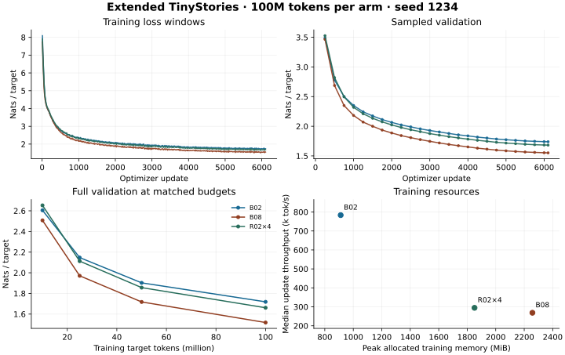
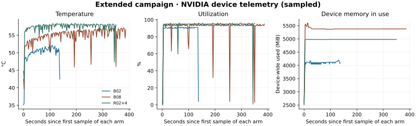

# Extended TinyStories v1 · final single-seed record

**Status: completed.** DML-0008 (B02), DML-0009 (B08) and DML-0010 (R02×4) each exited 0, completed 6,104 updates and scored **100,007,936 training tokens**. The archive records the 24 November 2026 Adelaide run and validation of its immutable checkpoints. No additional training was launched for publication.

## Question and protocol

Can cyclically tied depth recover some of B08's loss improvement over B02 at equal training tokens and reduce B08's measured training cost? R02×4 shares B02's parameter count and B08's applied depth. Reduced stored parameter and AdamW bytes are a calculable prediction. Quality and peak/rate differences are empirical.

All arms used width 640, ten heads, MLP width 1728, tied 4,096-token head, learned 512-position table, attention dropout 0, microbatch 16 and accumulation 2. Each update draws 32 disjoint 513-ID segments for 16,384 loss targets. Training seed 1234 and sampler seed 1235 share one TinyStories v1 stream and tokenizer. AdamW used peak LR 0.0006, 200 warmup updates, final ratio 0.1, cosine horizon 6,104, decay 0.1 on matrices, betas (0.9, 0.95) and norm clip 1.0. In-loop validation used 25 batches every 250 updates plus the final step. Checkpoint cadence was 500 plus 610, 1,526, 3,052 and the final step. There were no protocol deviations.

Deterministic CUDA used CUBLAS setting `:4096:8`, PyTorch 2.15.0+cu132, Windows 11 build 26200, Python 3.13.17, RTX 5080 driver 621.01 and BF16 autocast with FP32 weights and AdamW on local NVMe. [Source d914684](https://github.com/CL-BAF/Domovoi-Labs/commit/d914684dc730cd32132aeff389d6291c447ed7e4) · [Run configs and telemetry](data/archive/extended-v1/) · [Data and tokenizer provenance](../datasets/preparation-and-tokenization.md)

## Completed results

| Arm | Final train NLL | Sampled val NLL | Sampled PPL | Median synced tok/s | Median ms/update | Peak allocated / reserved MiB | Trainer wall s |
|---|---:|---:|---:|---:|---:|---:|---:|
| DML-0008 · B02 | 1.7376 | 1.7389 | 5.69 | 783,432 | 20.91 | 911.57 / 1110 | 135.1 |
| DML-0009 · B08 | 1.5522 | 1.5513 | 4.72 | 268,678 | 60.98 | 2257.50 / 2450 | 386.5 |
| DML-0010 · R02x4 | 1.6874 | 1.6820 | 5.38 | 294,759 | 55.58 | 1851.17 / 2050 | 348.2 |

The shared **1,800-second** deadline applied across all arms. Retained timestamps place the supervisor launch at about 08:06:45 and the last successful result at 08:21:22 Adelaide time, approximately **877 s** end to end. Trainer wall sums to **869.8 s**, with the remainder covering launch/setup and recording. The arm time projections supplied to the safety checks were 180, 480, and 410 s. Each arm stopped at its declared step budget rather than a resource limit.

| Arm | Logged pre-clip norm min–max | GPU samples | Max sampled °C | Max sampled utilization | Max sampled device use | Committed checkpoints |
|---|---:|---:|---:|---:|---:|---:|
| B02 | 0.7261–3.6667 | 68 | 52.17 | 91% | 4194 MiB | 16 |
| B08 | 0.4947–3.3109 | 190 | 57.08 | 95% | 5597 MiB | 16 |
| R02x4 | 0.7068–4.3766 | 172 | 58.46 | 96% | 4983 MiB | 16 |

Allocator peaks are from the training process. The NVIDIA values are approximately two-second device-wide samples and include all other workloads. All **48 extended checkpoints** were verified against stored file hashes. The manifest preserves file sizes, paths relative to the data root and digests. [Artifact manifest](../provenance/artifact-hashes/2026-11-24-local.json)

## Full FP32 validation at matched budgets

These are publication-time evaluations of the saved checkpoints, covering the same 4,783,349 eligible targets in 21,990 official validation documents. Each aggregate is nats/target, including EOS and partial windows, with no cross-document targets. Intervals in [the raw evaluation JSON](data/archive/extended-v1/) bootstrap documents conditional on this one training seed.

| Step | Training target tokens | B02 | B08 | R02×4 |
|---:|---:|---:|---:|---:|
| 610 | 9,994,240 | 2.6053 | 2.5076 | 2.6528 |
| 1526 | 25,001,984 | 2.1471 | 1.9706 | 2.1125 |
| 3052 | 50,003,968 | 1.9023 | 1.7174 | 1.8562 |
| 6104 | 100,007,936 | 1.7185 | 1.5181 | 1.6612 |

[Figure methods](../methodology/measurement-methodology.md) · [Scoring methods](../methodology/evaluation-methodology.md)

## Interpretation and limits

At 9,994,240 tokens R02×4 trailed B02 by **0.04756 nats/target**. By 25,001,984 it led by **0.03464**. B08 led both at all four extended checkpoints. At 100,007,936 R02×4 improves on B02 by **0.05731 nats/target** and trails B08 by **0.14319** or **9.43%** of B08 NLL. The gain relative to B02 is **28.58%** of B08's improvement, computed as (B02 NLL − recurrent NLL)/(B02 NLL − B08 NLL). This is descriptive and the positive denominator is specific to these runs.

Relative to B08, R02×4 saves **406.33 MiB (18.00%)** allocated and 400 MiB reserved, with **9.71% higher** median synchronized throughput. It uses 939.60 MiB more allocated memory than B02. Among these three arms, B08 has the lowest final validation loss, B02 has the lowest peak allocation and highest rate, and R02×4 is intermediate in the final loss ranking. Which trade is preferable depends on the quality or resource budget. Time-matched results could differ because the arms spend different wall time per token.

The change from early calibration is compatible with different learning curves and LR horizons. The within-extended checkpoints establish the observed B02/R02×4 ranking reversal without relying on comparing different schedules. No run isolates initialization, LR sensitivity or corpus effects, and there is one paired seed. The test partition is sealed. Task capability, distribution transfer, 8K context and 4 GiB inference remain open. [Hypotheses and proposed checks](../findings/architecture-hypotheses.md) · [Reproduction](../reproduce/README.md)
